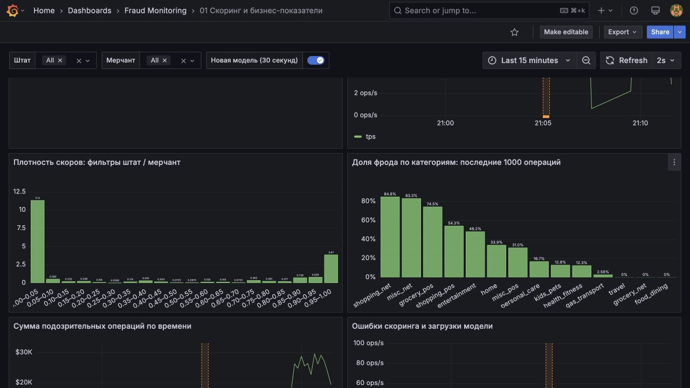
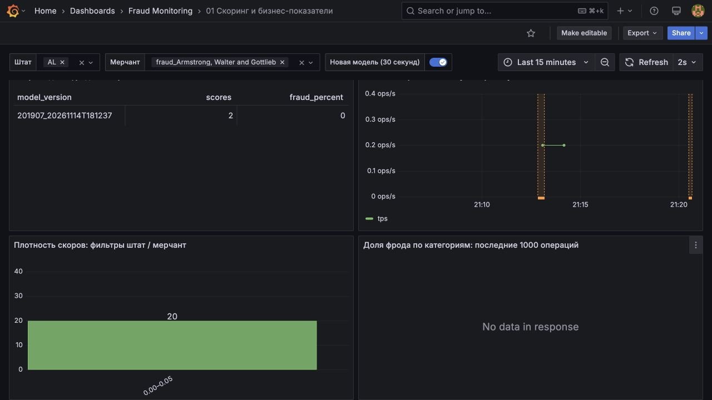
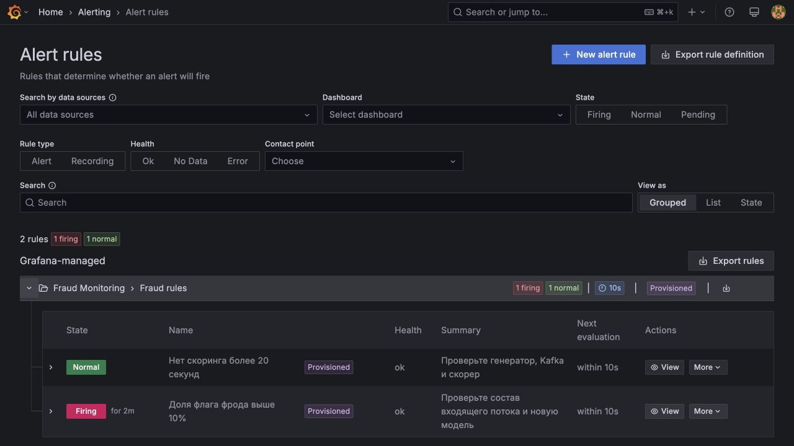
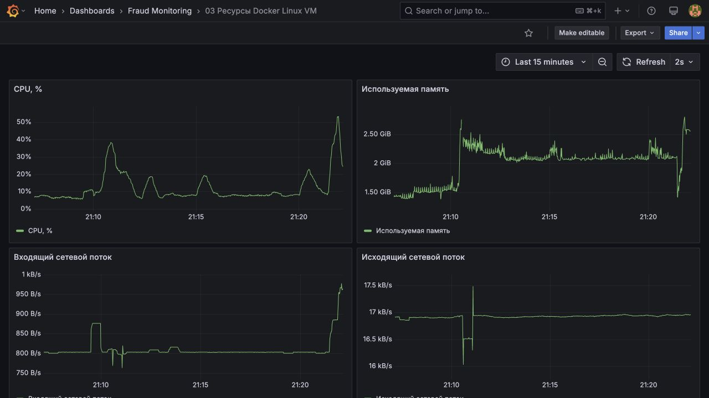

# Результаты проверки

Прогон выполнен 14 ноября 2026 года в Docker Desktop на macOS. Использовались
реальные строки поставляемого CSV с новыми UUID, а не заранее нарисованные метрики.

## Поток и панели

[monitoring-check.json](monitoring-check.json): три target UP, три дашборда,
24 панели с непустыми данными. Все пять SQL-панелей проверены с All и конкретными
штатом/мерчантом. На итоговом снимке в PostgreSQL 7387 строк, семь версий модели,
у новых строк нет UNKNOWN в бизнес-полях. Число строк продолжает расти при запуске.

Фильтры проверены также в браузере: выбор AL и мерчанта меняет TPS и плотность.
Пустой график категорий для редкого сочетания допустим: фильтр применяется после
выбора последних 1000 операций всего потока.

## Горячая смена модели

[model-reload-check.json](model-reload-check.json): ручной DAG
`monitoring_hot_reload` завершился с success. Опубликована версия
`201907_20261114T181237`. Время старта контейнера скорера до и после одинаковое,
RestartCount=0. Аннотация новой версии содержит 30 последовательных отсчётов
при шаге одна секунда. Затем появились скоры с новой версией в PostgreSQL.

На скриншоте ниже сохранён промежуточный этап с тремя версиями. В итоговом прогоне
при 5 ГБ ручной DAG `monitoring_5gb_20261114T184356` завершился примерно за 13 секунд
и опубликовал `202002_20261114T184407`. Записаны скоры новой версии, аннотация содержит
29 отсчётов с шагом одна секунда. Все контейнеры сохранили время старта и RestartCount=0:
[full-stack-check-5gb.json](full-stack-check-5gb.json).

Тест [model-reload-unit.log](model-reload-unit.log) проверяет реальную функцию
`make_pred`: начальную загрузку, смену версии вместе с порогом и сохранение прежней
модели при ошибке чтения нового файла. Модель в этом изолированном тесте заменена
маленьким FakeModel; интеграционный DAG выше использовал настоящий CatBoost.

## Алерты

- [alert-no-flow.json](alert-no-flow.json): остановлен генератор, скорер оставлен
  работать. Правило отсутствия потока перешло в firing при фактическом значении
  около 79 секунд, health=ok.
- [alert-high-fraud.json](alert-high-fraud.json): генератор подал строки target=1
  без передачи target модели. Доля модельных флагов достигла 87.3%, правило firing,
  health=ok.
- [alerts-recovered.json](alerts-recovered.json): после возврата обычного потока
  оба правила inactive / Normal, health=ok.

Это срабатывания по условиям, а не по состоянию NoData.

## Запись и миграция

[duplicate-delivery-check.json](duplicate-delivery-check.json): пять повторов
уже записанного transaction_id увеличили только writer_duplicates_total на 5.
Число успешных INSERT и количество наблюдений histogram не изменились.
Скрипт сначала приостанавливает генератор и дожидается опустошения очереди.

[postgres-init-check.json](postgres-init-check.json): отдельный временный PostgreSQL
успешно выполнил init.sql, затем zz_monitoring.sql. Таблица содержит 12 полей,
Grafana имеет SELECT без INSERT. Миграция дважды применена к старой таблице:
исходная строка сохранена, новые текстовые поля заполнены UNKNOWN. Временная БД
после проверки удалена, основные тома не затрагивались.

## Полный стек при 5 ГБ

[full-stack-check-5gb.json](full-stack-check-5gb.json): полный функциональный прогон
при MemoryMiB=5120 прошёл. Docker показывает около 4.8 GiB доступной памяти гостевой
Linux-системы. Одновременно работали Airflow, Kafka UI, Streamlit и весь мониторинг.
Все пять HTTP endpoints отвечали до и после обучения; три target оставались UP.
У всех 14 контейнеров, включая две успешно завершённые одноразовые задачи,
RestartCount=0 и OOMKilled=false. Время старта и ID контейнеров до и после совпадают.
После обучения повторно проверены все 24 панели, SQL-фильтры и Normal обоих алертов.

Начальный heap Kafka — 128 МБ, максимальный — 512 МБ; heap Kafka UI ограничен.
Частый healthcheck брокера проверяет TCP без запуска отдельной JVM. Создание топиков
проверяется отдельной задачей kafka-setup. Для запуска рекомендуется выделить Docker
4–6 ГБ. Это функциональный прогон с переобучением, а не длительный нагрузочный тест.

При прежнем лимите 2.84 GiB и параллельных проектах возникали OOM и рестарты:
[runtime-memory-check.json](runtime-memory-check.json). После выделения 5 ГБ и
освобождения ресурсов повторный прогон выше завершился успешно.

Проверки синтаксиса Python, JSON дашбордов, docker compose config и git diff --check
пройдены. После прогона стек задания останавливается через docker compose down
без удаления именованных томов.
