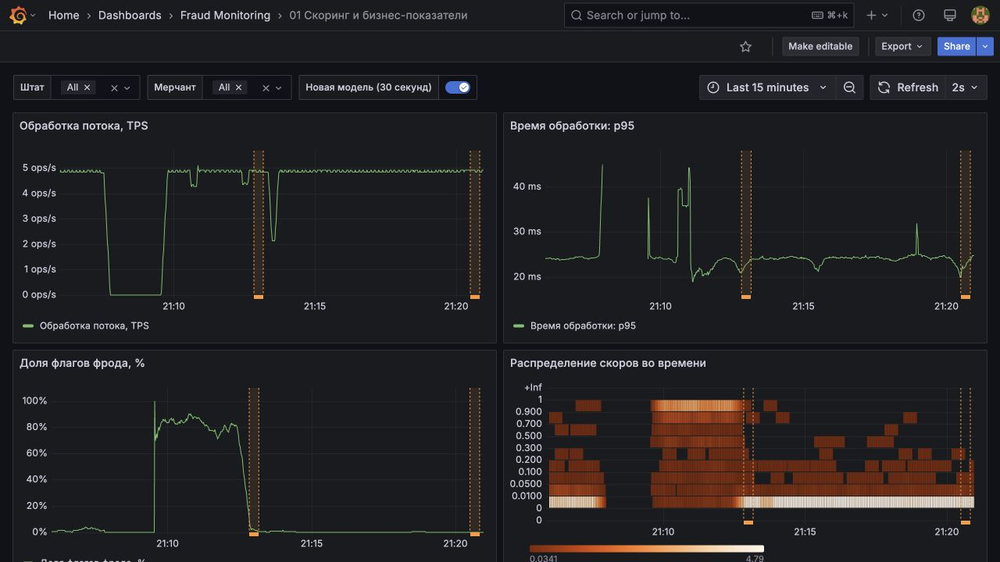
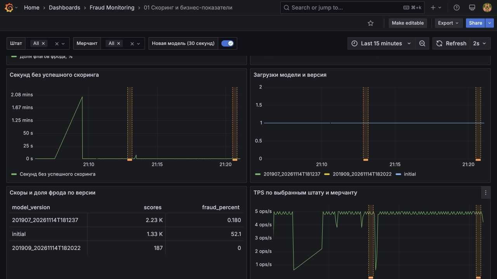
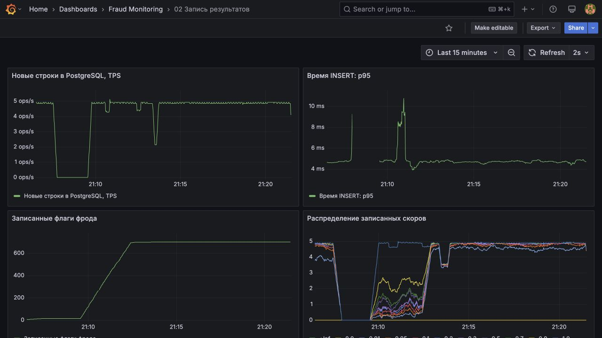
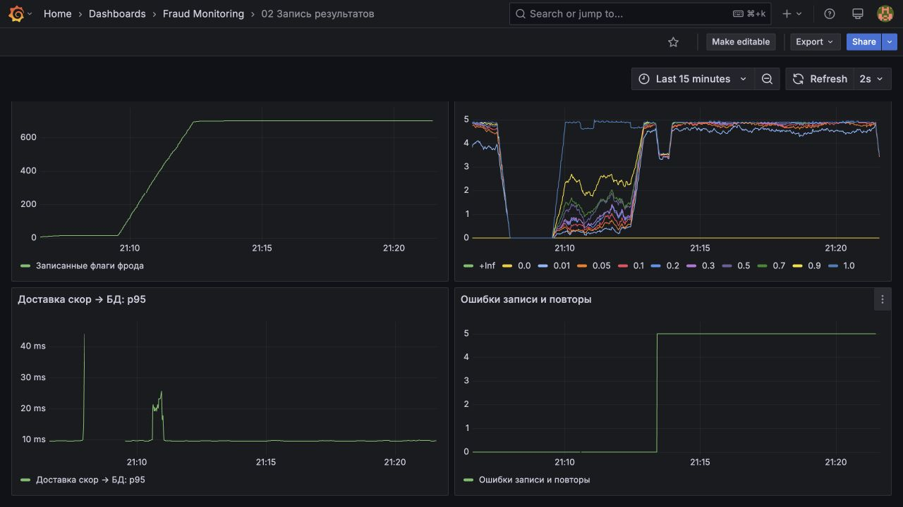

# Результаты проверки

Прогон выполнен 14 ноября 2026 года в Docker Desktop на macOS. Использовались
реальные строки поставляемого CSV с новыми UUID, а не заранее нарисованные метрики.

## Поток и панели

[monitoring-check.json](monitoring-check.json): три target UP, три дашборда,
24 панели с непустыми данными. Все пять SQL-панелей проверены с All и конкретными
штатом/мерчантом. На итоговом снимке в PostgreSQL 6449 строк, три версии модели,
у новых строк нет UNKNOWN в бизнес-полях. Число строк продолжает расти при запуске.

Фильтры проверены также в браузере: выбор AL и мерчанта меняет TPS и плотность.
Пустой график категорий для редкого сочетания допустим: фильтр применяется после
выбора последних 1000 операций всего потока.

## Горячая смена модели

[model-reload-check.json](model-reload-check.json): ручной DAG
`monitoring_hot_reload` завершился с success. Опубликована версия
`201907_20261114T181237`. Время старта контейнера скорера до и после одинаковое,
RestartCount=0. Аннотация новой версии содержит 30 последовательных отсчётов
при шаге одна секунда. Затем появились скоры с новой версией в PostgreSQL.

Позже штатное расписание опубликовало ещё одну модель: три версии видны в таблице.

Тест [model-reload-unit.log](model-reload-unit.log) проверяет реальную функцию
`make_pred`: начальную загрузку, смену версии вместе с порогом и сохранение прежней
модели при ошибке чтения нового файла. Модель в этом изолированном тесте заменена
маленьким FakeModel; интеграционный DAG выше использовал настоящий CatBoost.

## Алерты

- [alert-no-flow.json](alert-no-flow.json): остановлен генератор, скорер оставлен
  работать. Правило отсутствия потока перешло в firing при фактическом значении
  около 79 секунд, health=ok.
- [alert-high-fraud.json](alert-high-fraud.json): генератор подал строки target=1
  без передачи target модели. Доля модельных флагов достигла 87.3%, правило firing,
  health=ok.
- [alerts-recovered.json](alerts-recovered.json): после возврата обычного потока
  оба правила inactive / Normal, health=ok.

Это срабатывания по условиям, а не по состоянию NoData.

## Запись и миграция

[duplicate-delivery-check.json](duplicate-delivery-check.json): пять повторов
уже записанного transaction_id увеличили только writer_duplicates_total на 5.
Число успешных INSERT и количество наблюдений histogram не изменились.
Скрипт сначала приостанавливает генератор и дожидается опустошения очереди.

[postgres-init-check.json](postgres-init-check.json): отдельный временный PostgreSQL
успешно выполнил init.sql, затем zz_monitoring.sql. Таблица содержит 12 полей,
Grafana имеет SELECT без INSERT. Миграция дважды применена к старой таблице:
исходная строка сохранена, новые текстовые поля заполнены UNKNOWN. Временная БД
после проверки удалена, основные тома не затрагивались.

## Ресурсы и ограничения прогона

У Docker на этой машине лимит 2.84 GiB, параллельно работали другие проекты.
При запуске всех сервисов Kafka была остановлена OOM, а API Docker временно не
отвечал. После остановки дополнительных интерфейсов работа восстановилась.
Уменьшен начальный heap Kafka и ограничен heap Kafka UI, добавлен restart брокера; частый healthcheck
брокера проверяет TCP без запуска отдельной JVM. Создание топиков отдельно
проверено командой kafka-setup.

После изменений Kafka UI и Streamlit ответили HTTP 200, а Airflow отдельно
вернул healthy. Проверка всех 24 панелей также прошла при запущенных интерфейсах.
Но затем при работе расписания Airflow HTTP-соединение прервалось, а Kafka
перезапустилась три раза: длительная
стабильность полного стека на 2.84 GiB не подтверждена. Состояние контейнеров
сохранено в [runtime-memory-check.json](runtime-memory-check.json).

Для окончательной проверки полного стека нужно выделить Docker 4–6 ГБ и повторить
запуск и сценарий переобучения из README. При меньшем лимите там есть команда
запуска без двух дополнительных интерфейсов; даже для неё нужен запас на обучение.
Максимальный heap Kafka оставлен 512 МБ, чтобы не ограничивать брокер слишком
маленькой Java-кучей; начальный heap — 128 МБ. Полный прогон с этим окончательным
лимитом требует указанного увеличения памяти Docker. Его нельзя считать пройденным
нагрузочным тестом.
Настройки Docker и контейнеры других проектов не менялись.

Проверки синтаксиса Python, JSON дашбордов, docker compose config и git diff --check
пройдены. После прогона стек задания останавливается через docker compose down
без удаления именованных томов.
